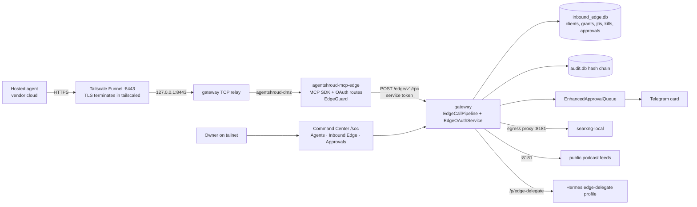
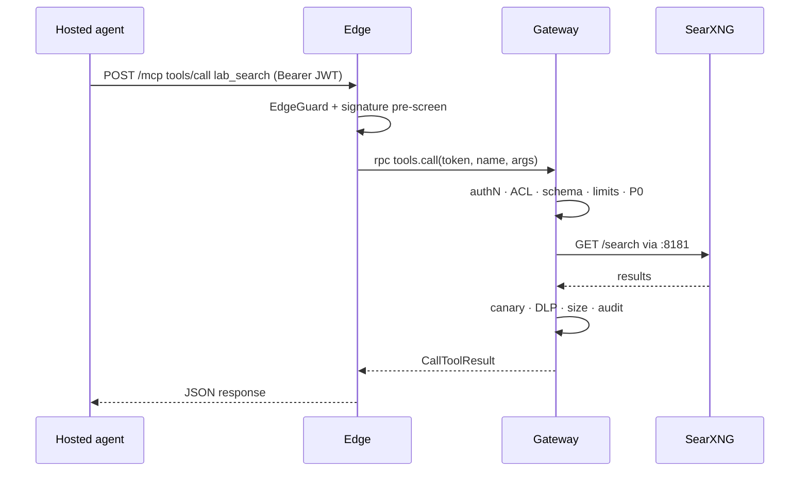
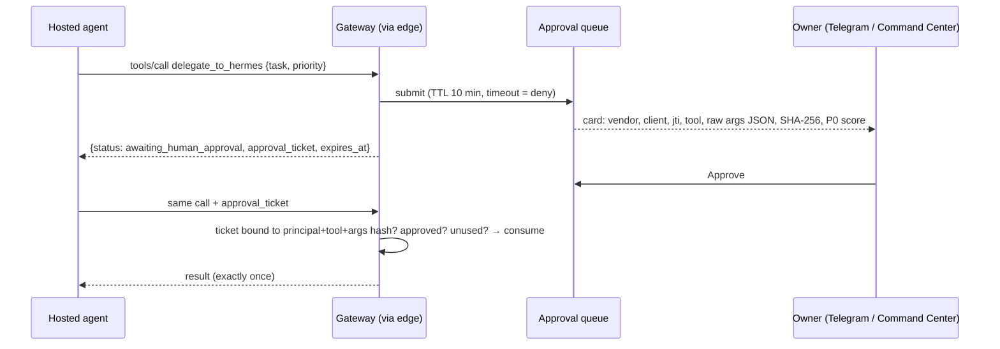

# Inbound MCP Edge — Design

## 1. Targets

| Item | Version | Source |
|---|---|---|
| MCP specification | 2026-07-28, plus legacy revisions the SDK still serves | modelcontextprotocol.io/specification/2026-07-28 |
| MCP Python SDK | `mcp==2.3.0` (2026-10-02) | pypi.org/project/mcp |
| OAuth | 2.1 profile with PKCE S256; RFC 8414, 9728, 7591, 8707, 7009 | MCP authorisation spec 2026-07-28 |
| Tailscale Funnel | Port 8443 (also allowed: 443, 10000) | tailscale.com/kb/1223/funnel |

## 2. Architecture



**Design rules**
- **The edge is a protocol terminator.** It holds the public key and a service token, and nothing else: no signing key, no policy, no state.
- **The gateway decides everything.** It reuses the existing singletons: PromptGuard, EncodingDetector, HeuristicClassifier, ProgressiveLockdown, CanaryTripwire, PIISanitizer, AuditStore, EnhancedApprovalQueue and the event bus.
- **Hosted agents are never the owner.** Every request runs as `edge:<vendor>:<client>`, so the pipeline's owner exemption can never apply.
- **The edge is off by default.** It starts only with `AGENTSHROUD_INBOUND_EDGE=1`, every vendor profile ships with `enabled: false`, and a bad descriptor manifest or profile refuses the edge without affecting the gateway.

## 3. Pipeline order (gateway, every `tools/call`)

| # | Step | Module | Notes |
|---|---|---|---|
| 0 | Route allowlist, 64 KB cap, no batches | `EdgeGuard` (edge) | |
| 0' | Bearer pre-screen (signature, aud, iss, exp) | `ProviderTokenVerifier` → `verify_signature_only` (edge) | |
| 1 | AuthN | `TokenService.verify_access` | jti issued, not killed, lockdown not SUSPENDED, allowed hours |
| 2 | Profile and tool ACL | | Hides local-agent tools in hosted-only mode |
| 3 | Strict JSON Schema | jsonschema 2020-12 | |
| 4 | Limits | | Client and vendor windows, daily budgets, concurrency, writes-disabled at ESCALATED |
| 5 | Tool-chain analysis (if wired) and P0 | | Over raw, normalised and decoded string leaves |
| 6 | Approval | `EdgeApprovals` | Writes only |
| 7 | Dispatch | Facade | |
| 8 | P2 canary | `CanaryTripwire` | |
| 9 | DLP and credential scrub | `PIISanitizer` | Per string leaf, so the JSON structure is kept |
| 10 | Size cap | | |
| 11 | Audit and event | `AuditStore` (`edge_call`), event bus `edge_event` | |

**Deviation from the brief.** Limits (step 4) run before P0 (step 5), so a flood costs a counter increment rather than a PromptGuard scan. Denials are audited either way.

## 4. Sequences

### Read call


### Write with approval


### Delegation to Hermes
```mermaid
sequenceDiagram
  participant G as Gateway
  participant H as Hermes /p/edge-delegate
  G->>G: wrap_untrusted(task, source=edge:<vendor>) → signed, delimited, defanged
  G->>H: POST /p/edge-delegate/v1/chat/completions (system: restrictions; user: wrapped task)
  H-->>G: reply (+ session id)
  G->>G: canary · DLP · audit links edge request id ↔ Hermes session id
```

## 5. OAuth and enrollment

**Enrollment sequence**
1. The owner enables the vendor profile.
2. The owner runs `asb edge enroll --vendor claude-duet` (tailnet). This opens a ten-minute window and prints a one-time code.
3. In the vendor's UI, the owner adds the custom connector URL `https://<node>.ts.net:8443/mcp`.
4. The vendor discovers the server through RFC 9728 and RFC 8414 metadata and registers through RFC 7591, which is accepted only inside the window and only for the vendor's allowlisted redirect URIs.
5. The owner's browser lands on `/oauth/consent` and the owner enters the code (three attempts).
6. The code is exchanged with PKCE and the `resource` parameter → a 15-minute ES256 access token plus a rotating refresh token.
7. Telegram confirms the link, with a one-line kill command.

**Secret storage.** Bearer secrets are hashed. Client secrets are sealed with AES-256-GCM under a key derived (HKDF) from the gateway-only signing key.

## 6. Command Center (tailnet only)

| Tab | Shows |
|---|---|
| **Agents** | One registry of local and hosted agents with a mode selector: Hosted only / Hosted + Local / Local only. The default mode comes from configuration. Agents watched only through host egress, or with no hook at all, appear with that honest status. |
| **Inbound Edge** | Per-vendor counters, live calls, kill/unkill, enrollment. |
| **Approvals** | All pending approvals. |

## 7. Known limits

- **Static bearer fallback** is not implemented; a profile that enables it is refused at load.
- **MCP Tasks extension.** The SDK has none yet, so approvals use the ticket-and-retry flow.
- **In-memory state.** Rate counters and statistics are in memory. Kills, grants and approvals persist.
- **`source_cidrs`.** The field is recorded and validated but not yet enforced: whether Funnel passes the client address through is unverified.
